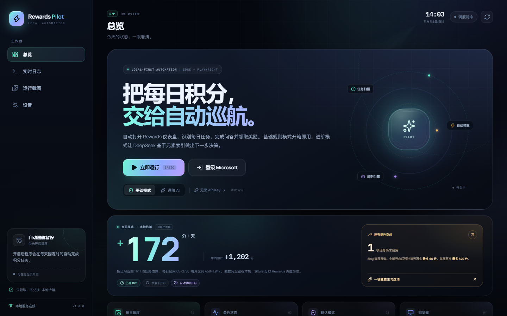
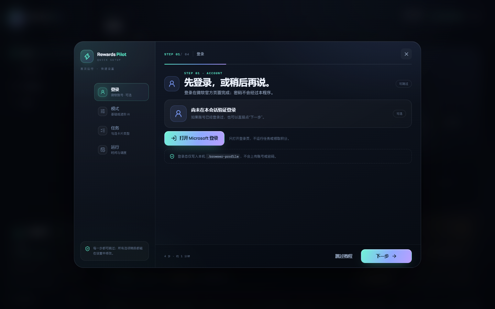
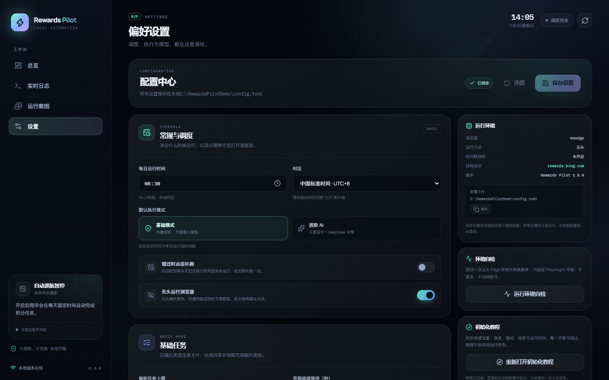
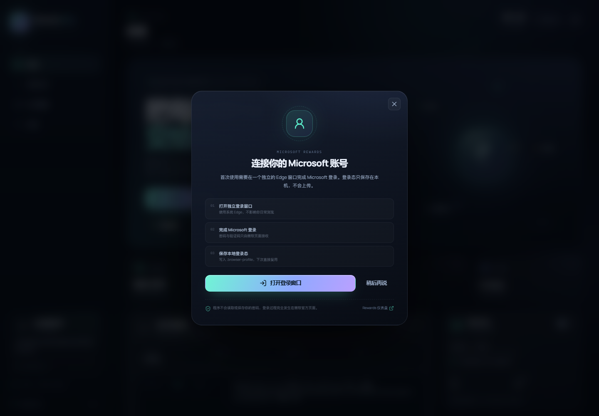
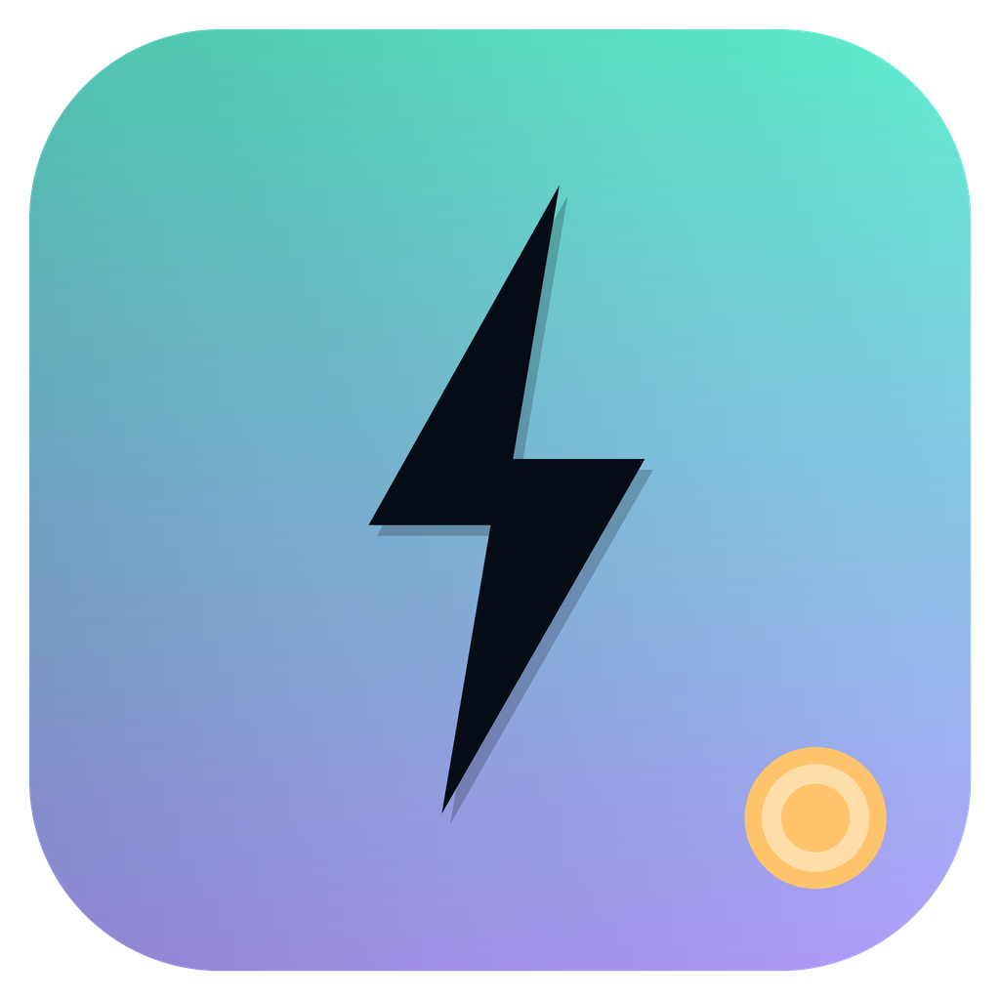

<div align="center">


**把每日 Rewards 任务，交给自动巡航。**

Windows 桌面端 · 复用本机 Edge 登录态 · 基础规则开箱即用 · 进阶模式交给 DeepSeek

简体中文 · [English](#english--english-summary)

[](https://github.com/ShirakawaFM/bing-reward-free/releases) [](LICENSE) [](https://www.microsoft.com/windows) [](https://www.python.org/) [](https://react.dev/) [](https://playwright.dev/) [](https://www.deepseek.com/) [](https://github.com/ShirakawaFM/bing-reward-free/stargazers)

作者：**ShirakawaFM / 白川方明**

</div>

> ⚠️ **非官方项目，与 Microsoft 没有任何关系。** 自动操作 Microsoft Rewards 可能违反其服务条款，可能导致积分被撤销、账号被限制或封禁。程序内置“不兑换、不购买、不修改账号、不离开允许域名”等护栏，但无法保证页面改版后仍然有效。请自行评估风险，建议先用小号或低价值账号试运行，不要第一次就无人值守。
>
> 开发测试期间曾打开过真实的每日任务链接，这类链接**仅打开就可能被 Rewards 计为已完成并发放积分**；还出现过一次隔离测试配置打开仪表盘并点击领取的情况。如果你不希望账号状态被改变，请不要运行本程序。
>
> 首页积分有两套数字：**预估区间是本地估算**，不碰账号；**积分证据是从任务页 DOM 里读到的真实余额与 `+N`**，只在运行中读取当前页面，不请求任何积分接口。两种情况都不会上传你的账号信息，配置、登录态、日志和截图全部留在本机。

---

## 下载

| 包 | 内容 | 适合谁 | 下载 |
| --- | --- | --- | --- |
| **Windows 成品版** | 单文件 EXE，内置后端、React 控制台与 Playwright 驱动 | 不想装 Python，双击就用 | [Bing-reward-FREE-v1.1.0-win64.exe](https://github.com/ShirakawaFM/bing-reward-free/releases/download/v1.1.0/Bing-reward-FREE-v1.1.0-win64.exe) |
| **原版代码** | 完整源码、构建脚本、测试与文档，不含登录态和配置 | 想阅读、修改或自行构建 | [Bing-reward-FREE-v1.1.0-source.zip](https://github.com/ShirakawaFM/bing-reward-free/releases/download/v1.1.0/Bing-reward-FREE-v1.1.0-source.zip) |
| **校验和** | 上面两个文件的 SHA256 | 下载后核对完整性 | [SHA256SUMS.txt](https://github.com/ShirakawaFM/bing-reward-free/releases/download/v1.1.0/SHA256SUMS.txt) |

> EXE 未签名，Windows SmartScreen 可能提示“未知发布者”；仅在确认来源可信时选择“更多信息 → 仍要运行”。也可以直接 `git clone` 本仓库。
>
> EXE 需要放在**可写目录**（桌面、文档等），不要放进 `Program Files` 或压缩包里直接运行。EXE **不内置浏览器**，使用系统自带的 Edge；换机器时重新登录即可。

---

## 三步跑起来

<div align="center">
<code>① 下载并双击 EXE</code>&nbsp; → &nbsp;<code>② 登录 Microsoft</code>&nbsp; → &nbsp;<code>③ 试跑一次，再开调度</code>
</div>

1. **下载 EXE**，放到一个可写文件夹，双击运行。首次启动会在 exe 旁边创建 `config.toml`、`queries.txt`、`logs\` 和 `state\`，并打开一个 Edge 应用窗口。
2. **跟着四步向导走**：登录 → 模式 → 任务 → 运行时间。每页只有一句大字标题和少量说明，右上角关闭、`Esc` 或“跳过教程”都不会写配置；只有最后一步“保存并进入”会保存你改过的选项。登录按钮只打开微软官方登录窗口，不会自动跑任务。
3. **先点“立即运行”试跑一轮**，在实时日志和运行截图里确认没有误点；再到 **设置 → 基础任务** 勾选要处理的卡片，最后打开 **每日调度**。关闭窗口会收进托盘，调度继续；要彻底退出请右键托盘图标。

> 第一次使用建议保持 `headless = false`，并有人在场。遇到验证码、登录失效或页面改版时，程序不会绕过，需要你手动处理。

<div align="center">
<a href="#这版有什么不一样">✨ 亮点</a>&nbsp; · &nbsp;<a href="#界面预览">🖼️ 界面</a>&nbsp; · &nbsp;<a href="#任务模式与任务清单">🧩 任务</a>&nbsp; · &nbsp;<a href="#低功耗挂机7-天">🔋 低功耗</a>&nbsp; · &nbsp;<a href="#安全设计与边界">🛡️ 安全</a>&nbsp; · &nbsp;<a href="#常见问题">❓ FAQ</a>
</div>

---

## 这版有什么不一样

| ✨ 亮点 | 说明 |
| :--- | :--- |
| 🧭 **四步首次向导** | 登录、模式、任务、运行时间四页；大字标题配小字说明，每页都可跳过，跳过不写配置 |
| 🎛️ **React 现代控制台** | React 19 + Vite，总览、实时日志、运行截图、设置四页，深色极光玻璃风格，桌面与窄屏自适应 |
| ⚙️ **基础模式开箱即用** | 不调用大模型，内置规则扫描卡片、识别测验/投票、作答、返回，并领取文字明确的 Claim 奖励 |
| 🧭 **新版任务页** | 默认打开 Rewards `/earn` 任务页；旧配置里的 `/dashboard` 自动迁移，并兼容服务端重定向 |
| 🤖 **DeepSeek 元素索引** | 把最多 140 个可见交互元素编号后交给模型决策，支持 `click / scroll / wait / back / navigate / finish` |
| ✅ **23 种任务清单** | 11 种基础卡片逐项勾选；4 种仅进阶 AI、6 种需人工处理的类型会显示但保持锁定 |
| 📈 **首页积分预估** | 大字显示每日 / 每周本地估算，列出未启用项与全部开启后的增量，一键跳到设置并高亮对应选项 |
| 🪟 **任务浏览器专属图标** | 自动打开的 Edge 任务窗口使用独立窗口图标，任务栏按钮叠加闪电徽标；不影响你现有的 Edge 窗口 |
| 🔋 **低功耗 7 天挂机** | 节能计划 + 空闲优先级 + EcoQoS + 阻止空闲休眠，可选白名单清理；程序始终保持单实例 |
| 📌 **托盘常驻** | 左键打开控制台；右键可立即运行、暂停调度、切换低功耗、打开日志文件夹或退出 |
| 🌅 **开机自启 + 跑完退出** | 开启一个开关，同时登记 Windows 当前用户启动项；每日定时任务成功后自动关闭托盘与后端，下次登录再回到托盘 |
| 🔒 **本地优先** | 后端只监听 `127.0.0.1` 并使用一次性令牌；登录态、日志、截图不出本机；API Key 不写日志 |


一次运行只做五件事：**打开任务页 → 扫描任务卡片 → 规则或模型决策 → 浏览与作答 → 只领取 Claim。** 不兑换、不购买、不修改账号。

---

## 界面预览

### 总览 · 大字积分预估与提升空间



### 首次运行 · 四步快速设置



### 设置 · 调度、任务清单与低功耗



### 登录 · 只打开微软官方登录窗口



> 截图来自隔离的演示配置（`C:\RewardsPilotDemo`），不包含真实账号、登录态或积分余额。

---

## 目录

<details open>
<summary><b>展开 / 收起</b></summary>

**开始使用**

- [下载](#下载) · [三步跑起来](#三步跑起来) · [这版有什么不一样](#这版有什么不一样) · [界面预览](#界面预览)
- [运行环境](#运行环境) · [从源码运行](#从源码运行) · [从源码构建 EXE](#从源码构建-exe)

**功能与配置**

- [功能细节](#功能细节) · [任务模式与任务清单](#任务模式与任务清单) · [低功耗挂机（7 天）](#低功耗挂机7-天) · [首页积分预估与提升空间](#首页积分预估与提升空间)
- [配置说明](#配置说明) · [每日定时：三种方式](#每日定时三种方式) · [Release 内容与校验](#release-内容与校验)

**安全与维护**

- [安全设计与边界](#安全设计与边界) · [日志与截图](#日志与截图) · [测试](#测试) · [常见问题](#常见问题)
- [项目结构](#项目结构) · [已知限制](#已知限制) · [常用命令速查](#常用命令速查) · [许可证与免责声明](#许可证与免责声明)

</details>


## 功能细节

- 每天固定时间运行（内置常驻调度器，也可交给 Windows 任务计划程序）。
- 持久化浏览器配置：只需手动登录一次，后续复用登录态。
- **现代动态 React 控制台**：总览、实时日志、运行截图、设置四个页面，桌面与窄屏自适应。
- **四步快速设置**：首次运行依次引导登录、模式、任务与运行时间，每页一句大字标题、少量说明、全部可跳过。跳过不写配置；只有最后一步保存改动，开启调度时不会补跑当天。
- **在界面里完成**：登录、立即运行、暂停/开启每日调度、编辑配置、环境自检、退出应用。
- **系统托盘**：启动后常驻通知区域。左键重新打开控制台；右键可立即运行（带确认框）、暂停/开启每日调度、切换低功耗挂机、打开日志文件夹或退出。关闭控制台窗口不会退出程序。
- **开机自启与跑完退出**：设置里的一个开关同时完成两件事——把程序登记到 Windows 当前用户的开机启动项，并在每日定时任务成功结束后关闭托盘与后端进程。开机登录后程序直接驻留托盘、不弹控制台；手动运行、失败的运行都不会触发退出，失败时会保留后台方便排查。
- **实时日志与运行截图**：按级别筛选/搜索日志，按任务批次查看关键页面截图。
- **任务清单勾选**：设置页按分组列出 23 种任务类型。11 种基础卡片可逐项勾选；4 种仅进阶 AI、6 种需人工处理的类型会显示但保持锁定。没勾选的卡片不会被打开。
- **首页积分预估**：按当前任务勾选、搜索和自动领取开关，用大字给出每日 / 每周的本地估算区间；同时显示还有哪些任务未启用、全部开启后能多拿多少。点击“还有提升空间”会直接跳到设置里未勾选的选项，并滚动、高亮对应卡片。
- **积分证据链**：运行时会从真实页面 DOM 里读余额和任务卡片上的 `+N`，并在每个任务前后各留一张截图。只有「任务后余额 > 任务前余额」且头尾截图齐全，这条任务才记为**已确认**；读不到数字就老实标「未确认」，绝不用本地估算补齐。总览页据此给出今日已确认积分、未确认任务数和每轮结算明细，截图可直接跳到截图库核对。
- **任务浏览器专属标识**：程序自动打开的 Edge 任务窗口会换成独立的闪电/仪表盘图标，并在任务栏按钮上叠加徽标；你自己已经打开的 Edge 窗口不会被改动。
- **低功耗挂机**：切换到 Windows 节能计划、把自身降到空闲优先级并启用 EcoQoS、阻止系统空闲休眠，目标连续待命 7 天；期间任务强制无头运行，只保留一个 Rewards Pilot 实例。可选清理仅限你勾选的白名单应用。
- 基础模式自动扫描 Rewards 任务页（`/earn`）的卡片，跳过“已完成 / 兑换 / 购买 / 设置 / 隐私 / 站外链接”等高风险内容。
- 自动识别常见测验/投票控件，选择选项并点击“下一页 / 提交 / 完成”等按钮。
- 对“打开即完成”的 Bing 搜索/阅读类任务，停留数秒后返回任务页。
- 只点击文字明确的“领取 / 领取奖励 / Claim”按钮，绝不点击“兑换 / Redeem”。
- 可选自动搜索（默认关闭，更容易触发风控）。
- **两级防检测（`[stealth]`）**：基础模式用本地规则给每次查询加 1–2 个字符的偏移、按右偏分布采样间隔、逐字输入；强力模式每轮只调用一次大模型规划整轮人类行为（带磁盘缓存与自动降级），把 token 压到最低。详见 [`[stealth]`](#stealth防检测)。
- 进阶模式：DOM 元素编号 + JSON 动作，最多 140 个可见交互元素，防止模型猜测不存在的元素。
- 完整的本地日志和失败截图，便于排查页面改版、登录失效、验证码等问题。
- API Key 只写入本机配置文件；界面接口只返回“是否已配置”，日志不记录 Key。

---

## 运行环境

- Windows 10 / 11。
- Microsoft Edge（推荐，系统自带；程序默认通过 Playwright 调用 `channel="msedge"`）。
- 能够访问 `rewards.bing.com`、`bing.com`、`api.deepseek.com`（进阶模式）。

**直接用 EXE**：只需要 Windows + Edge，不需要 Python、Node 或额外浏览器。

**从源码运行或重新打包**：

- Python 3.11 或更高版本（本项目已在 Python 3.14.8 上测试）。
- Node.js 18+ 与 npm（只用于构建前端；仓库中已带构建好的 `web/dist`）。
- 首次安装依赖需要访问 PyPI / npm registry。
- 系统托盘由 `pystray` + `Pillow` 提供，已写进 `requirements.txt`；缺失时程序会自动跳过托盘，退回关闭窗口即退出的行为。

> 为什么用系统 Edge：Playwright 自带的 Chromium 需要额外下载数百 MB，部分网络环境会卡住。直接调用已安装的 Edge 更省事。也可以在配置里改用 `chrome`，或留空 `browser_channel` 后执行 `python -m playwright install chromium`。EXE 已内置 Playwright 驱动，但**不内置浏览器**。

---

## 从源码运行

在项目目录中打开 PowerShell 或命令提示符：

```bat
cd /d C:\path\to\bing-rewards-bot

python -m venv .venv
.venv\Scripts\activate
python -m pip install -r requirements.txt
```

如果目录里已经有 `.venv`（本工作区已创建），可以跳过创建，直接激活或使用完整路径：

```bat
.venv\Scripts\python.exe -m pip install -r requirements.txt
```

确认 `config.toml` 存在；没有的话从示例复制：

```bat
copy config.example.toml config.toml
```

### 图形控制台（推荐）

打包版直接双击 `dist\RewardsPilot.exe`；从源码运行：

```bat
.venv\Scripts\python.exe desktop.py
```

会打开一个 Edge 应用窗口（不是普通浏览器标签页），四个页面分别是：

- **总览**：积分预估与提升空间、运行/登录入口、模式切换、最近状态、实时日志预览、每日计划与安全开关。
- **实时日志**：按 `ALL / INFO / WARN / ERROR` 筛选、搜索、复制、自动滚动。
- **运行截图**：按批次浏览任务页、问答页、领取结果等关键截图，支持放大和下载。
- **设置**：编辑调度时间、基础参数、任务勾选、低功耗挂机和 DeepSeek 接口，执行环境自检，退出应用。

首次启动时，控制台会自动弹出四步快速设置：登录、模式、任务、运行时间。跳过、关闭或按 Esc 都不会改动现有配置；只有最后一步“保存并进入”会写入改动。登录按钮只打开微软官方登录页；每日调度默认关闭，开启后从下一个计划时间开始，不补跑当天。所有选项之后都能在设置页修改。

首次使用：

1. 在总览点击“登录 Microsoft”，控制台会启动独立的 Edge 窗口。
2. 登录完成、页面回到 Rewards 后，点击“检查登录状态”。登录态会保存在 `.browser-profile`。
3. 点击“立即运行”先试跑一轮，查看实时日志和运行截图。首页积分预估会随任务勾选实时变化；点“还有提升空间”可直接跳到未勾选项。
4. 在设置里确认任务勾选和每日运行时间；需要长时间待命时再开启低功耗挂机。然后打开“每日调度”开关。

> Windows 上关闭控制台窗口只会把它收进系统托盘，后端、调度器和低功耗挂机继续运行；要真正结束程序，请右键托盘图标选择“退出 Rewards Pilot”，或在设置页点“退出应用”。托盘不可用时程序会退回“关闭窗口即退出”。也可以加 `--no-tray` 启动源码版，关闭行为与旧版一致。所有配置和截图都在本机，界面只监听 `127.0.0.1`。

### 首次登录（命令行）

```bat
.venv\Scripts\python.exe main.py --login
```

会打开有界面的 Edge：

1. 在弹出的浏览器里登录 Microsoft 账号，完成双重验证或验证码。
2. 等页面回到 Rewards 任务页后，回到终端按 Enter。
3. 登录态保存在 `.browser-profile` 目录，后续运行直接复用。

> 登录态会过期，也可能被 Microsoft 主动失效。遇到“登录已失效”时重新执行 `--login` 即可。

### 先手动试跑一次

```bat
.venv\Scripts\python.exe main.py --once
```

默认使用基础模式，执行一轮后退出。观察浏览器中的实际动作和终端日志，确认没有误点后再开启定时。图形控制台里对应“立即运行”按钮。

### 启动每日调度

```bat
.venv\Scripts\python.exe main.py
```

或双击 `start-scheduler.bat`。程序会常驻，按 `Ctrl+C` 停止。默认每天 `08:30`（`Asia/Shanghai`）运行。图形控制台里对应“每日调度”开关（保持窗口运行）。

---

## 任务模式与任务清单

### 基础模式（basic）

不调用任何 API。流程：

1. 打开 Rewards 任务页（`https://rewards.bing.com/earn`），扫描带链接的任务卡片。
2. 只保留带积分数字或“测验 / 投票 / 每日任务 / quiz / poll”等关键词的卡片，跳过已完成、兑换、购买、设置、隐私、站外链接。
3. 逐个打开任务：
   - 如果检测到测验/投票，自动选择第一个可用选项，然后点击“下一页 / 下一题 / 提交 / 投票 / 完成”等按钮，直到没有可操作项或达到轮数上限。
   - 如果没有测验控件，视为搜索/阅读类任务，滚动一下并停留 `read_wait_seconds` 秒后返回。
4. 返回任务页，继续下一个任务，最多 `max_tasks` 个。
5. 扫描“领取 / Claim”按钮，点击并确认领取弹窗。

运行：

```bat
.venv\Scripts\python.exe main.py --once -m basic
```

限制：基础模式是启发式规则，页面结构变化、任务类型变化、繁中/英文界面都可能影响识别率。它不会做需要手机 App、Xbox、购买或复杂交互的任务。

### 进阶模式（advanced，DeepSeek 元素索引）

程序每一步会：

1. 给页面中最多 140 个可见可交互元素打上临时编号（`data-qbot-id`）。
2. 把 URL、标题、页面文字（最多 3000 字）和元素列表压缩成 JSON。
3. 发给 DeepSeek（OpenAI 兼容 Chat Completions），要求只返回一个 JSON 动作：
   - `click`：点击某个编号元素；
   - `scroll` / `wait` / `back`：滚动、等待、返回；
   - `navigate`：只允许回到配置的任务页；
   - `finish`：结束本轮。
4. 执行前做安全校验：域名白名单、拒绝兑换/购买/支付/设置/退出/删除等文字和路径、禁止点击密码框、禁止导航到非任务页地址；点击后如果跳到登录页或站外域名会中止或返回任务页。
5. 防止模型卡死：连续 3 次无效输出、连续 6 次相同动作、达到步数/时间上限都会停止。

配置 API Key（二选一）：

```toml
[advanced]
api_key = "sk-你的 DeepSeek Key"
```

或使用环境变量（不要把真实 Key 写进截图、日志或 Git）：

```bat
set DEEPSEEK_API_KEY=sk-你的 DeepSeek Key
.venv\Scripts\python.exe main.py --once -m advanced
```

PowerShell：

```powershell
$env:DEEPSEEK_API_KEY = "sk-你的 DeepSeek Key"
.venv\Scripts\python.exe main.py --once -m advanced
```

也可以写 `api_key = "env:DEEPSEEK_API_KEY"`，程序会读取同名环境变量。

关于截图与视觉能力：

- 每一步都会把截图保存到 `state/screenshots/<时间>/`，用于排查问题。
- 官方 `https://api.deepseek.com` 目前是纯文本模型，**不能读图**；即使 `vision = true`，程序也会检测到官方域名并只发送文字和元素索引。
- 如果你换成支持视觉的 OpenAI 兼容接口，可以设置 `vision = true`，截图会以 base64 随请求发送。注意这会上传页面画面（可能包含账号信息）。
- 页面上可见的文字和元素会发送给模型。如果你介意隐私，请使用基础模式或改用本地模型。

### 任务清单与勾选（设置页）

**设置 → 基础任务** 会按分组列出 23 种任务类型，勾选结果保存到 `basic.task_types`，下一轮基础模式生效。

可直接勾选的 11 种卡片：

| 分组 | 任务类型 |
| --- | --- |
| 每日集锦 | 每日测验、每日投票、每日浏览与阅读、每日签到 / 打卡、二选一互动 |
| 每周与每月 | 每周集锦、每月集锦 / 月度打卡 |
| 更多活动 | 更多活动 · 测验、更多活动 · 投票、更多活动 · 浏览阅读、视频观看类 |

另外两个动作开关不属于卡片类型：**Bing 每日搜索**（`search_enabled`，默认关闭）和 **领取已完成的奖励**（`auto_claim`，默认开启）。即使把卡片全部取消，领取动作仍按自己的开关执行。

显示但锁定的 10 种：

- **仅进阶 AI**：推广 / 限时活动卡片、问卷与调查、特殊限时活动、连胜 / 连续记录保护。基础规则无法可靠判断文案和步骤，需要进阶模式让模型结合元素索引处理；这些项不能通过基础清单启用。
- **需人工处理**：移动端搜索、Xbox / Game Pass、Rewards App 专属、购买 / 购物返积分、邀请好友、完善资料 / 账户任务。它们分别需要手机、主机、真实联系人、支付或个人资料，程序不会自动完成；购买类尤其永远不会碰。

筛选方式：

1. 扫描任务页卡片后，按卡片文字和所在分区归类：先匹配人工/AI 专属关键词，再识别签到、二选一、测验、投票、视频，最后按“每日”或“其他”落回浏览类。
2. 只有归类结果在你勾选的 11 种卡片内，才会打开该卡片；未勾选、锁定或无法识别的卡片会跳过，并在日志里记录“未勾选 / 锁定类型”。
3. 设置页的“全选”勾上全部 11 种基础卡片；“推荐”恢复默认的 11 种。基础卡片一个都不勾时会提示，本轮只做领取（如果领取开关开启），不处理任务卡片。

> 这个勾选只影响**基础模式**。进阶模式仍由模型逐页判断，不受 `task_types` 限制。归类是启发式的：页面改版、语言差异或含糊文案可能让卡片落到浏览类，必要时查看日志中的归类结果。

### 低功耗挂机（7 天）

**设置 → 低功耗挂机** 用于长时间无人值守。开启后依次做这些事：

1. **切换电源计划**：读取当前计划，切换到 Windows 内置“节能”计划（GUID `a1841308-3541-4fab-bc81-f71556f20b4a`）。原计划会记到内存和 `state/power_mode.json`；退出或关闭低功耗时切回原计划，并删除这个恢复文件。若当前已是节能计划则不做切换。
2. **压低自身开销**：把 Rewards Pilot 当前进程的优先级降到 IDLE，并请求 Windows EcoQoS 执行速度节流。只作用于本程序，不改变其他进程；关闭时恢复正常优先级。
3. **阻止空闲休眠**：后台线程持续申请 `ES_SYSTEM_REQUIRED`，避免系统因空闲进入睡眠；显示器仍可关闭，锁屏不受影响。申请失败会显示警告。
4. **可选清理后台应用**：先扫描，只有白名单里的用户应用会出现在列表里；你手动勾选并二次确认后才执行。程序用 `tasklist` 取进程、按 PID 调用 `taskkill /F`，只结束所选白名单应用的进程。系统进程、Explorer、浏览器、Python 和 Rewards Pilot 自身都不在白名单，也不接受任意 PID。有任务或登录窗口运行时会自动跳过清理。
5. **强制无头运行**：低功耗开启期间，定时/手动任务会临时改用无头 Edge（登录窗口仍保持有头）；界面会暂停装饰动画并降低轮询频率。
6. **单实例**：程序启动时用命名互斥量保证只有一个控制台实例；再次双击 EXE 会提醒并聚焦已打开的窗口，而不会启动第二个进程，也不会结束已有实例。

白名单目前包括 OneDrive、Dropbox、Teams、Slack、Discord、微信、QQ、钉钉、Spotify、Steam、Epic、百度网盘、迅雷和 qBittorrent。关闭聊天或下载工具可能丢失未发送/未完成的内容，确认框里会再次列出。

恢复与异常：

- 正常关闭低功耗或退出应用时，会切回原电源计划、恢复进程优先级并释放唤醒锁；关闭控制台窗口只是收进托盘，不会中断挂机。
- 如果进程被强制结束或崩溃，恢复文件会留在 `state/power_mode.json`；下次启动会自动切回原计划并清理文件。
- 如果之后一直没有再启动程序，Windows 仍会停留在节能计划，需要在系统电源设置里手动切回。这个文件不保存账号或 Key。
- **7 天是目标，不是保证**。它能避免本程序因空闲休眠而中断，但停电、断网、手动睡眠、Windows 更新重启、登录态过期或验证码都可能让挂机停下。建议接通电源，并在 Windows 更新里推迟自动重启。

> “低功耗”指系统节能计划 + 本程序自身的效率模式 + 可选关闭白名单应用；它不会冻结整台电脑的所有进程，也不会绕过验证码、账号验证或网络限制。除你勾选的白名单应用外，不会杀任何进程。

### 首页积分预估与提升空间

**总览页顶部**会用大字显示当前模式下每天大约能增加多少分，副行是每周估算。这些数字是纯本地估算：

- 按已勾选的 11 种基础卡片、每类任务的常见积分区间计算；周任务按 1/7、月任务按 1/30 摊到每天。大字显示区间中值，下方同时给出每日和每周区间。
- Bing 每日搜索开启后，按每次 3 分、最多 30 次（90 分）计入每日上限。
- 自动领取关闭时，不会把“待领取奖励”算进预估；它会单独显示为一项可开启的动作。
- 仅进阶 AI / 需人工处理的锁定任务不计入；进阶模式下的数字仍以基础清单为基准，只额外标注 AI 可尝试的类型数量。
- **完全不读取账号余额**，也不代表 Microsoft 的官方积分；实际到账以 Rewards 页面为准。

右侧“还有提升空间”会列出尚未启用的任务或动作，以及全部开启后的每日 / 每周增量。点击整块卡片会跳转到 **设置 → 基础任务**，自动滚动到未勾选项并高亮一段时间；如果只是自动领取关闭，则高亮“领取已完成的奖励”动作行。11 种卡片与搜索都已启用、且自动领取开启时，改显示“没有提升空间”。

---

## 配置说明

配置文件为 TOML，相对路径以 **配置文件所在目录** 为基准。常用项：

### `[general]`

| 配置项 | 默认（示例） | 说明 |
| --- | --- | --- |
| `url` | `https://rewards.bing.com/earn` | 任务页地址，一般不改；旧配置的 `/dashboard` 会自动迁移到 `/earn` |
| `timezone` | `Asia/Shanghai` | 调度时区 |
| `run_at` | `08:30` | 每天运行时间，24 小时制 `HH:MM` |
| `mode` | `basic` | `basic` 或 `advanced` |
| `headless` | `false` | 是否无头运行；建议保持 `false`，便于发现验证码。低功耗挂机期间任务会临时强制无头，登录窗口除外 |
| `browser_channel` | `msedge` | `msedge` / `chrome`，留空用内置 Chromium |
| `slow_mo_ms` | `40` | 每次浏览器操作的额外延迟（毫秒） |
| `user_data_dir` | `.browser-profile` | 登录态/浏览器配置目录，切勿分享 |
| `state_dir` | `state` | 调度状态、截图目录 |
| `log_dir` | `logs` | 日志目录 |
| `catch_up` | `true` | 启动时若今天已过运行时间且尚未运行，立即补跑一次 |
| `auto_exit_after_run` | `false` | 每日定时任务成功结束后退出，并登记当前用户的开机启动项；需同时开启每日调度 |

### `[basic]`

| 配置项 | 默认 | 说明 |
| --- | --- | --- |
| `max_tasks` | `8` | 每轮最多尝试的任务数 |
| `max_rounds_per_task` | `14` | 每个任务最多“选答案/点继续”的轮数 |
| `auto_claim` | `true` | 自动点击明确的领取按钮 |
| `task_types` | 11 种基础卡片 | 基础模式要处理的卡片类型数组；设置页勾选会写回这里。仅接受基础卡片 id，未知或锁定类型会被拒绝 |
| `search_enabled` | `false` | 是否自动执行 Bing 搜索（有风控风险） |
| `search_count` | `20` | 每次搜索次数 |
| `search_delay_min/max` | `6 / 12` | 每次搜索后的随机等待秒数 |
| `search_host` | `https://www.bing.com` | 搜索主机 |
| `search_queries_file` | `queries.txt` | 搜索词文件，每行一个，`#` 开头为注释 |
| `read_wait_seconds` | `6` | 搜索/阅读类任务停留秒数 |

### `[advanced]`

| 配置项 | 默认 | 说明 |
| --- | --- | --- |
| `api_key` | 空 | DeepSeek Key；留空则读环境变量 |
| `base_url` | `https://api.deepseek.com` | OpenAI 兼容接口根地址 |
| `model` | `deepseek-chat` | 模型名 |
| `vision` | `false` | 是否发送截图；官方 DeepSeek 不支持 |
| `temperature` | `0.0` | 建议保持 0，减少随机动作 |
| `max_steps` | `40` | 最大模型步数 |
| `max_minutes` | `10` | 最大运行分钟数 |
| `timeout_seconds` | `90` | 单次 API 超时 |
| `allowed_hosts` | Rewards/Bing 域名 | 大模型模式允许访问的域名白名单 |

安全相关的配置不要随意放大：`max_steps`、`max_minutes` 越大，模型误操作的机会越多。

### `[stealth]`（防检测）

两种强度，**可以只开其中一个，也可以都关掉完全回到原始行为**。设置页「防检测」区块提供同样的开关。

| 配置项 | 默认 | 说明 |
| --- | --- | --- |
| `basic_enabled` | `true` | 基础防检测：查询字符偏移 + 右偏节奏 + 逐字输入（本地规则，零费用） |
| `strong_enabled` | `false` | 强力防检测：一次大模型调用规划整轮人类行为，带磁盘缓存 |
| `query_jitter` | `2` | 每次查询最多改几个字符：`1` 最保守、`2` 默认、`3` 变化更明显 |
| `typing_enabled` | `true` | 是否逐字输入搜索词；关掉后退回直接跳转搜索 URL（扰动仍生效） |
| `mouse_jitter` | `true` | 点击前移动鼠标、停留时随机漂移 |
| `break_probability` | `0.12` | 偶发长停顿概率（`0`–`0.9`），约每 8 次搜索多停一次 |
| `click_result_probability` | `0.15` | 点开一条搜索结果再返回的概率（`0`–`1`），`0` 表示只滚动/悬停 |
| `plan_max_tokens` | `700` | 强力模式单次剧本的 `max_tokens` 上限（`200`–`2000`） |
| `plan_cache_hours` | `12` | 剧本缓存有效期（小时），`0` 表示每次都重新询问模型 |
| `strong_max_page_text` | `1200` | 强力模式下每步发给模型的页面正文上限 |
| `strong_max_elements` | `45` | 强力模式下每步发给模型的元素条数上限 |

#### 基础防检测（`basic_enabled`）

纯本地规则，不产生任何额外网络请求或费用，建议常开：

- **查询偏移**：每次搜索前把查询改 1–2 个字符——同音/形近汉字替换（的↔得、在↔再、已↔己……）、
  英文相邻字母换位、QWERTY 邻键笔误、插空格或重复一个字符。语义保持高度一致，
  但每次发出去的 URL 都不完全相同。
- **节奏右偏**：等待时长不再是 `uniform(min, max)`，而是右偏采样（多数偏短、偶尔明显拉长），
  并带 `break_probability` 的“走神”停顿；每次采样结果都不一样。长停顿最多放大到 `search_delay_max` 的 2.2 倍。
- **人类化输入**：先回 Bing 首页、把鼠标移到搜索框、逐字符敲键（含偶发笔误 + 退格），
  结果页分段滚动、随机悬停，而不是一次性 `goto` 搜索结果 URL。
- 任务卡片与领取按钮的点击也会先移动鼠标再点，任务页停留改用同一套右偏采样。

#### 强力防检测（`strong_enabled`）

用大模型的“思考”能力规划整轮行为，同时把 token 压到最低：

1. **整轮只调用一次模型**，一次产出 N 条 `{q, dwell, scroll, hover, click}` 剧本，
   而不是每次搜索都问一次；`plan_max_tokens` 默认 700 就足够 20 条搜索。
2. **结果缓存**到 `state/stealth/plan-cache.json`（默认 12 小时）。同一天重复运行直接命中缓存，
   token 消耗为 0；命中后仍会用本地抖动重新采样停留时间与查询偏移，不会跑出完全相同的时序。
3. **失败自动降级**：没有 API Key、接口报错、模型输出不可解析时，自动退回本地人类行为模拟并记录原因，
   不会中断这一轮任务。
4. **每步观察压缩**：进阶模式下 `strong_max_page_text` / `strong_max_elements` 控制送给模型的
   页面正文与元素数量，减少每步输入 token。

每轮的计划来源、是否命中缓存、token 用量都会写进日志，同时落盘到
`state/stealth/last-plan.json`，方便核对“这一轮到底花了多少 token”。

> 防检测只是降低被识别的概率，不等于不会被识别。搜索积分本身仍可能触发 Rewards 风控，
> 请自行评估是否开启 `search_enabled`。

---

## 每日定时：三种方式

### 方式 A：图形控制台内置调度器（推荐日常使用）

在总览页或侧栏打开 **每日调度** 开关即可：

- 保持程序运行：窗口可以最小化，也可以关闭到系统托盘；托盘驻留期间调度器和低功耗挂机不会停。
- 左键托盘图标重新打开控制台；右键托盘图标可暂停/开启调度、切换低功耗、立即运行、打开日志或退出。
- 运行记录写入 `state/last_run.json`，同一天不会重复运行（手动“立即运行”除外）。
- 若 `catch_up = true`，启动时如果今天已过运行时间且今天还没跑过，会立即补跑一次。**第一次使用时**，如果不希望刚打开程序就运行，请先在设置里关闭“错过时点后补跑”，或暂时保持调度关闭。
- 从托盘重新开启调度时不会补跑，直接等待下一个计划时间；这样一次误点不会立刻启动真实任务。
- 保存设置时，如果调度正在运行，会按新配置自动重启调度。
- 要彻底结束程序，请右键托盘图标选择“退出 Rewards Pilot”，或在“设置 → 配置中心 → 退出应用”显式结束。

#### 可选：跑完自动退出与开机自启

在 **设置 → 基础任务** 打开“每日跑完自动退出（自动开机自启）”后，两项行为绑定生效：

- 程序会向 `HKCU\Software\Microsoft\Windows\CurrentVersion\Run` 写入名为 `Rewards Pilot` 的启动项，只对当前 Windows 用户生效，**不需要管理员权限，也不会创建计划任务**。
- 打包版登记 EXE 自身；源码版优先登记 `.venv\Scripts\pythonw.exe desktop.py`。两者都会带上 `--autostart --config <当前配置文件>`，确保开机后使用同一份配置。
- 开机登录时程序直接驻留系统托盘，不主动弹出控制台窗口；如果托盘不可用，会退回打开控制台，避免出现没有入口的后台进程。
- 只有 **每日调度** 触发且 **运行成功** 的任务才会自动退出：先给出托盘提示，等待任务线程收尾后关闭托盘、后端与调度器。手动“立即运行”和托盘“立即运行一次”不会触发退出。
- 本次运行失败时会 **保留后台** 并给出托盘提示，方便查看日志与截图；修好后可手动再跑，或等下一次定时。
- 关闭开关会立即删除启动项；每次启动也会按配置校正一次：路径变了会修复，开关关了会清理残留项。
- `state/last_run.json` 的去重仍然生效：同一天不会因为重新登录而重复补跑。它发生在 **Windows 用户登录时**，不是 BIOS 开机；如果电脑 24 小时不关机也不注销，退出后当天不会自己再出现。

### 方式 B：命令行常驻（源码版）

```bat
.venv\Scripts\python.exe main.py
```

- 终端进程必须一直运行；关闭终端或重启电脑后需要重新启动。
- 与方式 A 共用同一个 `state/last_run.json`，不要同时运行两个调度器。
- 其余补跑与去重逻辑同上。

### 方式 C：Windows 任务计划程序（无人值守，源码版）

适合不想一直开着窗口/终端的场景：

1. 确认 `run-once.bat` 与项目在同一目录，并且 `.venv` 可用。
2. 打开“任务计划程序” → “创建基本任务”。
3. 触发器选择“每天”，时间设为与 `run_at` 一致。
4. 操作选择“启动程序”：
   - 程序或脚本：`C:\path\to\bing-rewards-bot\run-once.bat`
   - 起始于：`C:\path\to\bing-rewards-bot`
5. 在任务属性中勾选“如果错过计划开始时间，尽快启动任务”。
6. 因为浏览器需要桌面会话，建议选择“只在使用者登录时运行”，并保持 `headless = false`；无头模式在“无论用户是否登录”的计划任务里更容易遇到启动或验证码问题。
7. 不要同时运行内置调度器，否则可能两个浏览器实例争用同一个 `.browser-profile`。

`run-once.bat` 只执行一次；日志同样写入 `logs/rewards_bot.log`。打包版没有独立的“只跑一次”命令行入口，无人值守调度请使用源码版，或保持控制台窗口运行。


## 安全设计与边界

程序内置以下护栏：

- **域名白名单**：基础模式只允许 `bing.com` / `rewards.bing.com` 及其子域；进阶模式还受 `allowed_hosts` 限制。
- **高风险文字/路径拦截**：兑换、购买、支付、充值、礼品卡、设置、隐私、退出登录、删除账号、`/redeem`、`/shop`、`/checkout` 等。
- **密码框不点击**。
- **只允许导航回任务页**；点击后进入站外域名会自动返回或中止。
- **领取只匹配明确的“领取 / Claim”文字**，不匹配“兑换”。
- **轮数、步数、时间上限**，避免无限循环。
- **任务勾选只打开已选的卡片类型**；未勾选、仅进阶 AI 和需人工处理的卡片会跳过。
- **初始化向导只在最后一步保存**：前 3 步只修改页面草稿；点“跳过教程”、右上角关闭或按 Esc 都不会写配置。登录按钮只打开微软官方登录窗口，任务浏览器必须由你主动运行；教程期间不会自动跑任务。只有最后一步“保存并进入”会写入改动，并且只有在向导中显式打开调度时才会启动，且不补跑当天。
- **教程状态不包含账号或密钥**：只在 `state/onboarding.json` 记录是否已查看、完成/跳过方式与时间；删除该文件后教程会重新出现，但不会影响配置、登录态或积分。
- **低功耗清理有白名单和二次确认**：只处理你勾选的用户应用，按 PID 结束进程；系统进程、Explorer、浏览器、Python 和 Rewards Pilot 自身永远不在清理范围，也不接受任意 PID。
- **低功耗改动可恢复**：只切换系统电源计划和本进程优先级；正常退出时恢复原计划，异常退出会在下次启动时读取 `state/power_mode.json` 恢复。
- **单实例互斥量**：第二次启动只会聚焦已有窗口，不会有两个实例同时争用登录态。
- **API Key 不写日志**；配置示例中的 Key 为空。
- **持久化浏览器目录不会提交 Git**（`config.toml`、`.browser-profile`、`state`、`logs` 已在 `.gitignore` 中）。

但这些护栏不是安全保证：

- 页面改版可能让“领取”匹配到错误按钮；任务归类也可能把含糊卡片放进错误的类型。
- 模型可能做出看似合理但不符合你意愿的点击。
- 页面文字会作为模型输入；如果页面包含“忽略以上规则”之类的恶意指令，模型可能被诱导，但仍受域名和高风险标签护栏限制。
- 自动搜索、频繁操作、无头浏览器都可能触发风控。
- 验证码、人机验证、账号异常需要你手动处理；程序不会绕过。
- 白名单清理仍会关闭聊天、同步或下载工具，可能丢失未发送消息、未同步文件或未完成下载；请只勾选确定不用的应用。
- 低功耗挂机无法保证 7 天不中断；断电、断网、手动睡眠、系统更新重启和登录过期都可能导致停止。

---

## 日志与截图

- `logs/rewards_bot.log`：按天滚动，记录扫描结果、模型决策、点击动作、错误堆栈。
- `state/last_run.json`：最近一次调度的日期。
- `state/onboarding.json`：初始化教程是否已查看、完成/跳过时间（不含账号信息或 API Key）。删除后下次启动会重新显示教程。
- `state/screenshots/<YYYYMMDD-HHMMSS>/`：启动、失败、模型每一步的截图。
- **实时日志** 页面会增量轮询后端，可按级别筛选、搜索、复制和自动滚动；完整日志同时落盘。
- **运行截图** 页面按任务批次分组显示，图片接口同样需要本地令牌，支持放大、键盘切换和下载。
- 控制台只显示关键信息；需要更多细节时加 `-v`：

```bat
.venv\Scripts\python.exe main.py --once -v
```

截图可能包含账号昵称、头像、积分余额，分享日志/截图前请先检查并打码。`.browser-profile` 包含可登录的 Cookie，**绝对不要打包发送给他人**。控制台、配置和截图都只保存在本机；后端只绑定 `127.0.0.1`。

---

## 测试

单元测试和离线 UI 测试不会访问线上 Rewards 账号：

```bat
.venv\Scripts\python.exe -m unittest discover -s tests -v
```

覆盖内容：

- TOML 配置解析、环境变量 Key 回退、非法时间/模式、相对路径、调度器日期计算。
- 初始化教程：首次显示、完成/跳过标记、损坏或旧版本标记重新显示、接口写入与非法动作拒绝、`/api/state` 不泄露 Key、首次运行暂缓自动调度；以及调度启动接口可选 `catch_up=false`、非法值被拒绝。
- 开机自启与跑完退出：源码版/打包版启动命令生成、注册表登记与删除的幂等、路径不匹配检测、仅“调度成功”触发退出、手动运行与失败运行不退出、任务完成监听、配置写回，以及设置接口开关联动启动项。
- 安全标签/链接拦截、域名判断、任务页 URL 判断、密码框拦截。
- LLM JSON 解析（普通 JSON、Markdown 围栏、坏 JSON）。
- Agent 动作归一化与边界裁剪。
- 本地 HTML 夹具上的任务扫描、领取扫描、测验识别、Bing 分页排除、隐藏单选框的 label 回退。
- 任务目录：23 种类型的完整性、分组、默认清单、卡片归类（分区/测验/投票/签到/视频/AI/人工），以及未知、AI 或人工类型写入 `task_types` 时被拒绝。
- 积分预估：默认清单的每日/每周区间、全选、搜索封顶、每周与每月摊算、空清单，以及“未启用项”增量与锁定项数量。
- 浏览器图标：图标资源存在、浏览器进程识别、只选取新句柄且新进程的可见窗口、无效窗口句柄被拒绝；不会改动已有 Edge 窗口。
- 低功耗：电源计划输出解析（内置/自定义）、`tasklist` CSV 解析、白名单不包含系统/浏览器、任意进程名被忽略、开启与关闭时计划恢复、已是节能计划时不写恢复文件、忙碌时跳过清理、异常退出后恢复原计划。
- 单实例：先启动的进程持有命名互斥量时，第二个进程退出；第一个结束后可再次启动。
- 托盘：图标资源、菜单状态文字、任务运行中/低功耗/调度的状态优先级、立即运行触发来源、运行前确认被拒时不启动任务、从托盘开启调度时关闭补跑、调度与低功耗开关的调用。
- 控制台窗口：退出时只关闭本实例打开或聚焦过的窗口，不会误关其他 Rewards 标题窗口。
- 基础模式离线集成：拦截请求并伪造任务页/搜索页，验证“扫描 → 打开任务 → 返回 → 领取”的完整流程。
- 进阶模式离线集成：启动一个本地假 OpenAI 兼容接口，验证模型观察元素、点击任务、答题、提交、finish 的完整循环，以及 Authorization 头和请求体。

这些集成测试使用 `https://rewards.bing.com/earn` 的拦截响应和临时浏览器配置，不读取 `.browser-profile`，也不会访问线上账号。

离线 UI 测试需要本机 Edge，会以 headless 方式启动；没有 Edge 时自动跳过。也可以单独跑：

```bat
.venv\Scripts\python.exe -m unittest tests.test_offline_ui -v
.venv\Scripts\python.exe -m unittest tests.test_basic_offline -v
.venv\Scripts\python.exe -m unittest tests.test_stealth -v
.venv\Scripts\python.exe -m unittest tests.test_agent_offline -v
.venv\Scripts\python.exe -m unittest tests.test_tasks_catalog -v
.venv\Scripts\python.exe -m unittest tests.test_onboarding -v
.venv\Scripts\python.exe -m unittest tests.test_autostart -v
.venv\Scripts\python.exe -m unittest tests.test_power_mode -v
.venv\Scripts\python.exe -m unittest tests.test_single_instance -v
.venv\Scripts\python.exe -m unittest tests.test_window_branding -v
.venv\Scripts\python.exe -m unittest tests.test_tray -v
.venv\Scripts\python.exe -m unittest tests.test_console_window -v
```

低功耗测试通过模拟系统电源调用检查切换参数与恢复逻辑，不会真正切换测试机的电源计划；单实例测试会临时启动两个 Python 子进程；图标测试只检查本地资源和窗口筛选逻辑，不会修改任何已打开的浏览器窗口；托盘测试使用假运行时，不创建托盘、不启动浏览器，也不访问账号。开机自启测试会把注册表读写替换为模拟对象，不会改动真实的启动项；自动退出测试使用假的调度结果，也不会启动浏览器。

编译检查：

```bat
.venv\Scripts\python.exe -m compileall -q rewards_bot gui main.py desktop.py tests
```


## 常见问题

**双击 EXE 没有窗口 / 被 SmartScreen 拦截**

- 确认文件没有被杀毒软件隔离；这是本地打包的未签名程序，可在确认来源后选择“更多信息 → 仍要运行”。
- 把 EXE 放在可写目录（桌面、文档等），不要放在 `Program Files` 或压缩包内直接运行。
- 启动失败时会在同目录生成 `logs/gui-crash.log`；查看里面的异常堆栈。
- 单文件版首次启动需要解压组件，等待 2–5 秒；如果窗口仍未出现，查看 `logs/rewards_bot.log` 中记录的本地地址，手动打开。

**关闭控制台窗口后，每日任务还会继续吗？**

会。Windows 上托盘可用时，关闭控制台只是把窗口收起来，后端、调度器和低功耗挂机继续运行；单击托盘图标即可重新打开。要结束程序，请右键托盘图标选择“退出 Rewards Pilot”，或在设置页点“退出应用”；退出时会恢复原电源计划，如果任务正在运行会等它结束（最多 15 分钟）。若托盘创建失败或启动时加了 `--no-tray`，关闭窗口仍会退出。

**开了“每日跑完自动退出”，第二天会自动启动吗？**

会在下一次 **Windows 用户登录** 时自动启动，并留在系统托盘；它不会退出后常驻内存等待第二天。若电脑整夜不关机、也不注销或重新登录，程序退出后不会自己回来。需要这种场景时，请改用任务计划程序每天触发（方式 C），或不要开启自动退出。另外，只有每日调度触发且运行成功才会退出；手动运行、运行失败都会保留程序。

**为什么运行失败后没有自动退出？**

这是有意的：失败通常意味着登录失效、验证码、页面改版或网络问题，直接退出会丢失现场。程序会保留托盘和后端，并弹出托盘提示；你可以打开日志和运行截图排查，修好后手动再跑，或等下一次定时。

**托盘图标在哪里？右键有哪些选项？**

在任务栏右下角的通知区域，图标是黑底薄荷色闪电；如果没直接看到，请点通知区域的上箭头（溢出区）查找。右键菜单包括：打开控制台、立即运行一次、每日调度开关、低功耗挂机开关、打开日志文件夹、退出 Rewards Pilot。左键图标默认打开控制台。“立即运行一次”会弹出确认框，默认按钮是“否”，避免误触启动真实任务；从托盘开启调度不会立刻补跑当天错过的任务。

**浏览器地址不是 8765？**

端口被占用时程序会自动顺延，日志里会打印实际地址；这是正常的。控制台使用一次性令牌绑定当前实例，请不要把地址发给别人。之前发现过 Windows 上 `SO_REUSEADDR` 导致端口被两个进程同时监听的问题，现已修复；启动时还会校验 `/api/health` 的应用名，避免打开到别的本地服务。

**首页显示的积分是我账号里的余额吗？**

不是。它只是按任务类型区间和勾选开关做出的本地估算，不读取账号信息，也不请求积分接口。同一任务在不同地区、账号等级下可能给不同分数，区间不一定完全准确；实际积分以 Rewards 页面为准。

**点“还有提升空间”后为什么只高亮部分选项？**

它只标出当前真正未启用的基础卡片或动作。锁定项（仅进阶 AI / 需人工处理）不会高亮，因为它们不能在基础清单里启用。如果只提示“1 项动作”，跳过去看到的是“领取已完成的奖励”开关。

**任务浏览器在任务栏里为什么还是 Edge 图标？**



程序会给任务窗口设置独立窗口图标，并在任务栏按钮上叠加薄荷绿闪电徽标。Windows 任务栏的主图标由 Edge 的 AppUserModelID 控制，外部程序无法稳定替换基座图标；窗口图标、Alt+Tab 和任务栏徽标仍能帮你快速认出任务浏览器。此过程只影响程序新开的窗口，不会修改你正在使用的 Edge 窗口。

**启动时报 `ZoneInfoNotFoundError: Asia/Shanghai`**

Windows 的 Python 不自带 IANA 时区库，安装 `tzdata` 即可（已在 `requirements.txt` 中）：

```bat
.venv\Scripts\python.exe -m pip install tzdata
```

**浏览器启动失败 / 提示配置被占用**

- 关闭其他正在使用 `.browser-profile` 的程序或上一次残留的 Edge 进程。
- 确认配置 `browser_channel = "msedge"`，或安装内置 Chromium：

```bat
.venv\Scripts\python.exe -m playwright install chromium
```

**提示“登录已失效”**

重新执行 `--login`。登录态会过期，特别是长时间未运行、修改密码、清理 Cookie 后。

**扫描到 0 个任务**

- 今天的每日任务可能已经完成；先手动看 Rewards 任务页确认。
- 页面语言/地区不同，关键词可能不匹配；查看 `logs/rewards_bot.log` 和截图。
- Rewards 页面可能改版，需要调整 `basic.py` 中的扫描规则。
- 账号可能被限制或处于验证状态。

**打开了任务但没加积分**

Rewards 的每日任务有打开即完成、答题、投票、阅读等多种形式；本程序只覆盖常见类型。部分任务需要 App、Xbox、购买或等待到账，程序不会处理。

**没有找到“领取”按钮**

积分可能已经自动到账，或领取入口改版。程序只点击文字明确的领取按钮，这是有意的保守设计。

**勾选了任务，为什么有些卡片没执行？**

- 勾选只影响基础模式；进阶模式不受清单限制。
- 带“仅进阶 AI / 需人工处理”的 10 种类型不能通过基础清单启用。
- 每轮受 `max_tasks` 限制，前面卡片已占满名额。
- 卡片归类是启发式的，可能被判成未勾选的类型；日志会写“未勾选 / 锁定类型”。
- 卡片可能已完成、缺少积分数字，或被高风险规则跳过。

**低功耗模式会让电脑睡眠或关机吗？**

不会主动睡眠或关机，反而会阻止系统因空闲进入睡眠；显示器仍可关闭。手动点“睡眠”、合上笔记本盖子、断电或 Windows 强制重启仍可能中断挂机，具体取决于系统电源策略。

**低功耗清理会杀系统进程吗？**

不会。清理只在白名单里列出用户应用，必须由你手动勾选并在确认框里确认，再按 PID 结束对应进程。系统进程、Explorer、浏览器、Python 和 Rewards Pilot 自身不在白名单，任意名称也不会被执行。有任务或登录在跑时会跳过清理。

**关闭低功耗后电源计划没恢复？**

正常关闭会切回开启前的计划。若程序崩溃或被强制结束，下次启动会读取 `state/power_mode.json` 自动恢复；如果之后一直没再启动，需要到 Windows 电源设置里手动切回。切换失败通常是权限或系统策略导致，日志会给出 `powercfg` 的错误。

**低功耗能保证挂机整整 7 天吗？**

不能保证。7 天是目标：程序会保持自身运行并阻止空闲休眠，但停电、断网、手动睡眠、系统更新重启、登录态过期或验证码都可能中断。建议接通电源、允许网络访问，并推迟 Windows 自动重启。

**第二次双击 EXE 没反应？**

程序只允许一个实例。第二次启动会显示提示并尝试聚焦已打开的控制台窗口，不会新建后端。如果窗口已经关闭到托盘，请单击通知区域里的 Rewards Pilot 图标重新打开。若确实需要重启，请右键托盘图标选择“退出 Rewards Pilot”，或结束残留进程后再启动。

**DeepSeek 返回 401 / 402 / 429**

- 401：Key 错误或过期。
- 402：账户余额不足。
- 429：频率限制，稍后再试或降低调用频率。
- 检查 `advanced.base_url` 是否与 Key 匹配（官方 Key 对应 `https://api.deepseek.com`）。

**进阶模式总是 `finish` 或点击失败**

查看 `logs/rewards_bot.log` 中每一步的模型决策和元素列表。常见原因：API 不支持 JSON 模式、模型输出格式不稳定、页面元素 id 在页面变化后失效。程序已对常见情况做重试和结束保护。

**遇到验证码 / 人机验证**

程序不会绕过。请手动在浏览器中完成验证，再重新运行。建议保持 `headless = false`，并有人在场时首次运行。

**自动搜索开不开？**

默认关闭。自动搜索最容易触发 Rewards 风控，收益也不稳定。确认风险并愿意承担后再设置 `search_enabled = true`。

---

## 项目结构

```text
bing-rewards-bot/
├─ desktop.py               # GUI/EXE 入口（启动本地控制台）
├─ main.py                  # CLI 入口：登录 / 单次 / 调度
├─ config.example.toml      # 配置模板（Key 为空）
├─ config.toml              # 实际配置（已被 .gitignore 忽略）
├─ requirements.txt         # 运行时依赖
├─ requirements-build.txt   # 打包/前端工具依赖
├─ queries.txt              # 可选搜索词
├─ start-scheduler.bat      # 双击启动常驻 CLI 调度
├─ run-once.bat             # 给任务计划程序调用
├─ gui/
│  ├─ server.py             # Flask + waitress、令牌/安全头、SPA 与 API、窗口与托盘生命周期
│  ├─ tray.py               # 系统托盘、右键菜单、运行确认框
│  ├─ services.py           # 任务 / 登录 / 调度线程服务
│  ├─ power_mode.py         # 低功耗挂机、电源计划恢复、白名单清理
│  ├─ onboarding.py         # 首次运行教程状态（state/onboarding.json）
│  ├─ autostart.py          # 当前用户开机启动项、命令生成与状态校正
│  ├─ settings_store.py     # 配置读取、校验、原子写入
│  └─ log_buffer.py         # 实时日志环形缓冲
├─ rewards_bot/
│  ├─ config.py             # TOML 加载、校验、默认值、路径解析
│  ├─ tasks_catalog.py      # 23 种任务目录、归类规则、task_types 校验
│  ├─ browser.py            # Edge 持久化配置、登录检测、截图、弹窗处理
│  ├─ basic.py              # 基础模式：按清单扫描、测验、领取、搜索
│  ├─ dom.py                # 元素观察/编号、安全护栏、URL 判断
│  ├─ llm.py                # OpenAI 兼容接口、重试、JSON 解析
│  ├─ agent.py              # 进阶模式循环与动作执行
│  ├─ stealth.py            # 防检测：查询偏移、右偏节奏、逐字输入、大模型行为剧本与缓存
│  ├─ runner.py             # 一次完整运行的编排
│  ├─ scheduler.py          # 每日调度与补跑
│  ├─ window_branding.py    # 任务浏览器专属窗口图标与任务栏徽标
│  ├─ paths.py              # 源码 / PyInstaller 路径解析
│  ├─ single_instance.py    # 命名互斥量与聚焦已有窗口
│  └─ logging_setup.py
├─ web/                     # React 19 + Vite 控制台
│  ├─ src/
│  │  ├─ components/        # 含 OnboardingWizard（初始化教程）、PointsForecast、TaskPicker、LowPowerPanel
│  │  ├─ views/             # 总览、日志、截图、设置
│  │  └─ hooks/             # 状态轮询与低功耗降频
│  ├─ public/
│  ├─ dist/                 # 前端构建产物（后端直接提供）
│  ├─ package.json
│  └─ vite.config.js
├─ assets/
│  ├─ app.ico               # EXE 图标
│  ├─ app-icon.png
│  ├─ task-browser.ico      # 任务浏览器窗口图标（同时打包进 EXE）
│  ├─ task-browser-icon.png
│  ├─ banner.svg            # README 横幅（1280×420 动态 SVG）
│  ├─ divider.svg           # 章节分隔线
│  ├─ flow.svg              # 一次运行的五步
│  └─ footer.svg            # 页脚签名
├─ packaging/
│  ├─ RewardsPilot.spec     # PyInstaller onefile 配置
│  └─ version_info.txt      # Windows 文件版本信息
├─ docs/screenshots/        # README 截图
├─ tests/
│  ├─ test_config.py
│  ├─ test_guards.py
│  ├─ test_onboarding.py    # 教程状态、接口与首次运行安全行为
│  ├─ test_autostart.py     # 开机自启、启动命令与跑完自动退出（模拟注册表）
│  ├─ test_tasks_catalog.py # 任务目录、归类与配置校验
│  ├─ test_stealth.py       # 防检测：查询偏移、节奏采样、剧本缓存与降级
│  ├─ test_window_branding.py # 浏览器图标资源与窗口筛选
│  ├─ test_power_mode.py    # 电源计划、恢复、白名单清理（模拟命令）
│  ├─ test_single_instance.py
│  ├─ test_tray.py          # 托盘动作、状态文字与运行确认
│  ├─ test_console_window.py # 退出时只关闭本实例的控制台窗口
│  ├─ test_offline_ui.py
│  └─ ...
├─ dist/RewardsPilot.exe    # 打包产物
├─ .browser-profile/        # 登录态（敏感，不提交）
├─ state/                   # 教程/调度状态、截图、低功耗恢复文件（不提交）
└─ logs/                    # 运行日志（不提交）
```

---

## 已知限制

- 页面是 Next.js 动态应用，Microsoft 随时可能改版；基础模式依赖文字/结构启发式，不能保证长期有效。
- 不同地区、语言、账号等级的任务类型不同。基础模式覆盖 11 种常见卡片和领取，但问卷、推广活动、连胜保护等仍需进阶 AI；移动端、Xbox、Rewards App、购买、邀请好友和账户资料任务不自动处理。
- 任务勾选依赖启发式归类；卡片文案含糊、页面改版或非中英文界面可能把任务归到错误类型，导致漏做或按浏览类处理。
- 无法保证一定拿到积分，领取按钮出现时间也可能晚于程序运行时间。
- 首页积分只是按任务类型区间做的本地估算，不读取余额；地区、账号等级、任务刷新和实际发放规则都会影响结果，可能偏高或偏低。
- Edge / Chrome 的任务栏主图标由 AppUserModelID 控制，程序只能设置窗口图标并叠加任务栏徽标；少数系统主题或第三方任务栏工具可能不显示徽标。
- 自动搜索默认关闭，且即使打开也可能被判定为异常流量。
- 进阶模式依赖模型输出质量；元素索引和页面文字会增加 token 消耗。
- 低功耗挂机只能降低系统电源计划和本程序自身的开销，并可选关闭白名单应用；不会冻结所有进程，也不保证连续 7 天不中断。
- 开机自启只在 **当前 Windows 用户登录时** 触发，不创建计划任务，也不申请管理员权限。电脑长期不关机、不注销也不重新登录时，自动退出后当天不会再次自动出现。
- 自动退出只在 **每日调度触发且运行成功** 时发生；运行失败或手动运行都会保留后台。重启后能否补跑仍受 `catch_up` 和 `state/last_run.json` 控制。
- 不处理验证码、人机验证、账号安全验证，也不绕过任何限制。
- 本项目仅用于学习浏览器自动化与 LLM 页面操作，不提供任何形式的账号或积分保证。

---

## 常用命令速查

```bat
:: 安装依赖
.venv\Scripts\python.exe -m pip install -r requirements.txt

:: 启动图形控制台（源码，默认带托盘）
.venv\Scripts\python.exe desktop.py

:: 启动图形控制台（不创建托盘，关闭窗口即退出）
.venv\Scripts\python.exe desktop.py --no-tray

:: 启动打包版
dist\RewardsPilot.exe

:: 首次/重新登录（命令行）
.venv\Scripts\python.exe main.py --login

:: 基础模式跑一次
.venv\Scripts\python.exe main.py --once -m basic

:: 进阶模式跑一次（需 Key）
.venv\Scripts\python.exe main.py --once -m advanced

:: 常驻每日调度（命令行）
.venv\Scripts\python.exe main.py

:: 调试日志
.venv\Scripts\python.exe main.py --once -v

:: 跑测试
.venv\Scripts\python.exe -m unittest discover -s tests -v

:: 编译检查
.venv\Scripts\python.exe -m compileall -q rewards_bot gui main.py desktop.py tests
```

---

## 从源码构建 EXE

需要 Windows、Python 3.11+、Node.js 18+。运行时依赖与打包依赖分开安装：

```bat
.venv\Scripts\python.exe -m pip install -r requirements.txt
.venv\Scripts\python.exe -m pip install -r requirements-build.txt
```

先构建前端，再用 PyInstaller 生成单文件 EXE：

```bat
cd web
npm install
npm run build
cd ..

.venv\Scripts\python.exe -m PyInstaller --noconfirm --clean packaging\RewardsPilot.spec
```

产物为 `dist\RewardsPilot.exe`。构建说明：

- `packaging/RewardsPilot.spec` 会把 `web/dist`、`config.example.toml`、`queries.txt`、`assets/app.ico`、`assets/task-browser.ico` 和 Playwright 驱动一起收进单文件。
- 托盘依赖 `pystray` 与 `Pillow`，spec 里补了 `pystray._win32` 隐藏导入；Pillow 的图像插件由 PyInstaller 钩子收集。托盘图标使用内置的 `assets/app.ico`。
- **不打包浏览器**：运行机器需要系统 Edge（默认 `browser_channel = "msedge"`），这也让 EXE 小了数百 MB。
- EXE 图标来自 `assets/app.ico`，任务浏览器窗口图标来自 `assets/task-browser.ico`；版本信息来自 `packaging/version_info.txt`。这些只在重新构建时使用。
- EXE 采用窗口模式（无控制台）。启动崩溃会写入同目录的 `logs/gui-crash.log`。
- 单文件包必须放在可写目录；程序首次运行会把示例配置和搜索词表复制到 exe 旁边。
- 开机自启项指向 EXE 的绝对路径。移动或重命名 EXE 后，下次启动会按新路径自动校正；如果移动后还没启动过，请先手动打开一次。
- 如果修改了前端，需要重新执行 `npm run build` 后再打包，否则 EXE 里仍是旧页面。

---

## Release 内容与校验

每个 Release 都同时提供**成品程序**与**原版代码**：

| 附件 | 说明 |
| --- | --- |
| `Bing-reward-FREE-v1.1.0-win64.exe` | Windows 10/11 单文件成品。内置 Python 后端、`web/dist` 前端和 Playwright 驱动；需要系统 Edge，不内置浏览器 |
| `Bing-reward-FREE-v1.1.0-source.zip` | 由 `v1.1.0` 提交的 Git 树直接导出的源码包，包含前端源码与构建产物、测试与文档；不包含 `config.toml`、`.browser-profile`、`state/`、`logs/` 或任何 Key |
| `SHA256SUMS.txt` | 两个附件的 SHA256，下载后可用 `certutil -hashfile <文件> SHA256` 核对 |

本版 EXE 信息：

```text
文件名：Bing-reward-FREE-v1.1.0-win64.exe
大小：60,515,353 字节
SHA256：bfe452876767cfc2605eb0ad3afc1b771db361c9355788928bb89931614880ab
```

> 源码包是构建这个 EXE 的同一份代码快照。EXE 由本机 PyInstaller 6.22.3 构建，不是 CI 产物；重新构建的二进制不会与官方附件逐字节一致，但源码、依赖清单与构建步骤都包含在源码包中。

> **版本说明**：`v1.1.0` 新增「两级防检测」与「积分证据链」——前者用本地规则给每次查询加轻微偏移、按右偏分布采样节奏并逐字输入，强力档再让大模型一轮只调一次、产出整轮人类行为剧本（带盘缓存与自动降级）；后者从真实页面读取余额与任务 `+N`，任务前后各留截图，只有余额确实增长且截图齐全才记为已确认，读不到就标未确认。`v1.0.1` 是「开机自启 + 每日定时成功跑完后自动退出」，并把任务入口切换到新版 Rewards `/earn` 页面。旧版本附件仍保留在历史 Release 中，但不再推荐下载。

---

## 许可证与免责声明

代码以 [MIT License](LICENSE) 开源，Copyright (c) 2026 ShirakawaFM。

本项目仅用于学习浏览器自动化、桌面应用与 LLM 页面操作，不提供任何形式的账号、积分或可用性保证。使用本程序造成的账号限制、积分撤销或其他损失由使用者自行承担。Microsoft、Bing、Microsoft Rewards、DeepSeek 等名称归各自所有者所有，本项目与它们没有关联，也未获其授权。

---

## English / English Summary

**Bing-reward FREE** is a local-first Windows desktop assistant for Microsoft Rewards daily tasks. It reuses your local Edge session, opens the Rewards earn page on a schedule, completes common quiz / poll / read cards with built-in heuristics, and claims only explicit “Claim” rewards. An optional advanced mode sends an indexed list of up to 140 interactive elements to DeepSeek (or any OpenAI-compatible endpoint) for step-by-step decisions, with domain and high-risk-text guards. An optional one-switch mode registers the app for the current Windows user's startup and exits the tray and backend after a successful scheduled run; manual runs and failed runs keep it alive. Everything runs on `127.0.0.1`; cookies, logs, screenshots and API keys stay on your machine. It is not affiliated with Microsoft, and automating Rewards may violate Microsoft's terms of service. Use at your own risk. Requires Windows 10/11 and Edge; the release EXE is unsigned.


